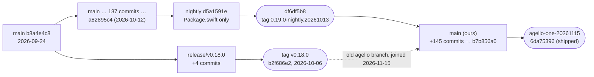

# Versions

> **Scope:** what Agello ships and what this reference documents; how LiteRT-LM numbers its releases,
> C API and container format; how upstream tags releases and nightlies; the upstream changes from
> v0.18.0 (which Agello shipped until 2026-10-28) to our base; which build each performance figure was
> measured on.
> **Out of scope:** the generated table of every pin and model ([generated/version-matrix.md](generated/version-matrix.md));
> how builds and releases are made ([litert-lm/build-and-release.md](litert-lm/build-and-release.md));
> each of our commits ([patches.md](patches.md)); the C and Swift APIs in detail
> ([litert-lm/c-api.md](litert-lm/c-api.md), [litert-lm/swift-api.md](litert-lm/swift-api.md));
> the container format ([litert-lm/file-format.md](litert-lm/file-format.md)).
> **Pinned to:** `main` `b7b856a0`: LiteRT-LM at the root (Google's base `df6df5b8`), LiteRT in
> `agello/litert`, ML Drift in `agello/ml_drift`; Agello ships release `agello-one-20261115` (`6da75396`).
> **Applies to:** all platforms (version scheme); Apple (what Agello ships). **Last verified:** 2026-11-17

## Summary

- **Agello ships** our release `agello-one-20261115`: its `CLiteRTLM.xcframework` (built from
  `6da75396`, build `0c749789100a`, iPhone and Mac slices on Metal), checksummed in the vendored
  `Package.swift`, and the Swift wrapper from `main` at `82b05ea1`: the release's wrapper plus four
  commits that change it (the files' notices, Swift 6 language mode, the embedding engine's
  activation type, the flags behind an `NSLock`). <!-- c:LM-VER-001 --> <!-- c:LM-VER-002 -->
- **This reference documents** our build, `main` at the pin: Google's `0.19.0-nightly.20261013`
  (`df6df5b8`) plus 141 commits of ours, with LiteRT and ML Drift built from the same tree; the
  release Agello ships has 68 of them. <!-- c:LM-VER-028 -->
- Versions, in our build and in the release: LiteRT-LM 0.19.0 (in development), C API 1.0.0 (every
  function returns a status code), container version 1.9.0. Google's v0.18.0, which Agello shipped
  until 2026-10-28, had 0.18.0, 0.2.0 and 1.7.0. <!-- c:LM-VER-003 --> <!-- c:LM-VER-019 -->
- v0.18.0 is not an ancestor of the documented base: it was cut on `release/v0.18.0` from `main` as
  of 2026-09-24. <!-- c:LM-VER-010 -->
- Our Swift wrapper needs our binary: C API 1.0 with our build-info and telemetry functions.
  <!-- c:LM-VER-009 -->
- Performance figures: Agello's README leads with our build's figures of 2026-11-17 and keeps the
  table it measured with Google's v0.18.0 binary in October 2026 as history; VALIDATION's cooled
  calibration table of 2026-10-15 is our build `2e54fbdb9ca9`, and its afternoon follow-ups builds
  `11beef01e805` and `fc71d704a349` ([C16](#performance-figures-which-build)).

## Concepts

| Version | Where it lives | At the pin | In the release Agello ships |
| --- | --- | --- | --- |
| LiteRT-LM version | `VERSION` in `version.bzl`: the release in development | `0.19.0` | `0.19.0` |
| C API version | `C_API_VERSION` in `version.bzl`; since 1.0.0 also the `LITERT_LM_C_API_VERSION_*` macros in `c/engine.h` | `1.0.0` | `1.0.0` |
| Container version | `LITERTLM_{MAJOR,MINOR,PATCH}_VERSION` in `schema/core/litertlm_header.h` (the C++ runtime uses only the major); Google's Python builder, which our tree removed (prune `7e4d9b8d`), writes its own copy of them into new `.litertlm` headers | `1.9.0` | `1.9.0` |
| Upstream release tag | `vX.Y.Z` on `release/vX.Y.Z` | (none: the base is a nightly; Google released v0.19.0 later, on 2026-11-02) | (none) |
| Our release tag | a tag on the `main` commit a release is built from, the zip attached to its GitHub release ([build-and-release.md](litert-lm/build-and-release.md#the-release-script)) | (none) | `agello-one-20261115` |
| Nightly tag | `<VERSION>-nightly.<YYYYMMDD>` on `nightly` | `0.19.0-nightly.20261013` (the base) | the same base |
| Framework bundle version | `CFBundleShortVersionString` in the XCFramework's `Info.plist` ([`agello/Info.plist:11-12`](https://github.com/PowerBeef/agello-litert-lm/blob/b7b856a0cf7e2304f556e985218bc698768233f7/agello/Info.plist#L11-L12)) | `0.19.0` | `0.19.0` |
| Build id | our stamp ([build-and-release.md](litert-lm/build-and-release.md#build-stamping)) | `6ddc6b998303` for the local build of the pin | `0c749789100a` |

`version.bzl`'s own comment says `VERSION` is "the next version", bumped after every release
([`version.bzl:17-23`](https://github.com/google-ai-edge/LiteRT-LM/blob/df6df5b84d5845b49889f631ed4cac80b4325dd3/version.bzl#L17-L23)): upstream bumped it to 0.19.0 in `93d74126` on 2026-10-06, the day
v0.18.0 was published. <!-- c:LM-VER-012 -->

## What ships and what is documented

| | Agello ships (today) | This reference documents |
| --- | --- | --- |
| LiteRT-LM source | release `agello-one-20261115`, built from `6da75396`: base `df6df5b8` plus the 68 commits [generated/patch-log.md](generated/patch-log.md) marks ✓ | `main` `b7b856a0`: base `df6df5b8` plus 145 commits (141 ours; the other four are Google's v0.18.0 release-branch commits, which came along when the old `agello` branch joined `main` on 2026-11-15), 1,810 files differing outside the LiteRT and ML Drift folders |
| Swift wrapper used | `swift/` from `main` at `82b05ea1` (the release's plus Swift 6 language mode `24f35f81`, the embedding engine's activation type `1a90cdb4` and the flags behind an `NSLock` `82b05ea1`), vendored into Agello `Vendor/LiteRT-LM` | `swift/` at the pin, the same files |
| Native binary | the release's `CLiteRTLM.xcframework.zip`, build `0c749789100a`, iPhone and Mac slices | `dist/CLiteRTLM.xcframework` built by `agello/build-xcframework.sh`, build `6ddc6b998303` |
| LiteRT | `agello/litert` at `6da75396` | `agello/litert` at the pin: imported unchanged at `e3c93749` from `PowerBeef/LiteRT` `362759838` (Google `ca21dc99` + 12), then 17 commits |
| ML Drift | `agello/ml_drift` at `6da75396` | `agello/ml_drift` at the pin: imported the same way from `PowerBeef/ml-drift` `15fa9e2` (Google `1b18771f` + 8), then 16 commits |
| GPU on iPhone and Mac | Metal accelerator, linked statically; CPU sampling | the same |
| JSON / tool constraints | llguidance only (`--config=agello`) | the same |
| Build info | `litert_lm_get_build_info()` | the same |

<!-- c:LM-VER-027 -->

Until 2026-10-28 Agello shipped Google's v0.18.0 binaries. That release's macOS framework,
`CLiteRTLM_mac` (2026-10-06), ran the GPU on the WebGPU accelerator (its strings name "GPU WebGPU",
no "GPU Metal") <!-- c:RT-OTH-005 -->; the iPhone app on a Mac used the iOS framework instead, as it
uses the release's iOS slice now. <!-- c:APL-061 -->

Agello's vendored `Vendor/LiteRT-LM/Package.swift` (at Agello `a691212`) names one binary target,
the release's `CLiteRTLM.xcframework.zip` with checksum `90b641a52ae0…`; in the fork the same target
points at `dist/` ([`Package.swift:38-41`](https://github.com/PowerBeef/agello-litert-lm/blob/6da75396ece779d3c7b6b605ec8c2c06861ce1eb/Package.swift#L38-L41)), and `Vendor/use-release-litert.sh` writes
the release's URL and checksum in. Agello's manifest named Google's v0.18.0 zips from its first
commit (`f63e552`, 2026-10-07), our release `agello-next-20261024` from `0efaffe` (2026-10-28), and
`agello-one-20261115` from `39daed1` (2026-11-15). <!-- c:LM-VER-002 -->

Our wrapper and our binary go together:

- `Engine` creates the engine with `litert_lm_engine_create(settings, out)`, the C API 1.0 form
  that returns a status code ([`swift/Engine.swift:185-189`](https://github.com/PowerBeef/agello-litert-lm/blob/b7b856a0cf7e2304f556e985218bc698768233f7/swift/Engine.swift#L185-L189),
  [`c/engine.h:1104-1109`](https://github.com/google-ai-edge/LiteRT-LM/blob/df6df5b84d5845b49889f631ed4cac80b4325dd3/c/engine.h#L1104-L1109)).
- `BuildInfo` and `Telemetry` call `litert_lm_get_build_info` and `litert_lm_telemetry_*`
  ([`swift/BuildInfo.swift:21`](https://github.com/PowerBeef/agello-litert-lm/blob/b7b856a0cf7e2304f556e985218bc698768233f7/swift/BuildInfo.swift#L21), [`swift/Telemetry.swift:36-43`](https://github.com/PowerBeef/agello-litert-lm/blob/b7b856a0cf7e2304f556e985218bc698768233f7/swift/Telemetry.swift#L36-L43)), which our binary exports
  ([generated/binaries.md](generated/binaries.md)) and Google's v0.18.0 binary didn't (its record of
  2026-10-16, "Ours only"). The wrapper Agello shipped until 2026-10-28, v0.18.0's plus two Swift
  patches, called the C API 0.2 form, which returns the engine pointer. <!-- c:LM-VER-009 -->

So a new runtime means vendoring both halves together, which is what `Vendor/use-local-litert.sh`
and `Vendor/use-release-litert.sh` do
([build-and-release.md](litert-lm/build-and-release.md#the-release-script)).

## How upstream versions and tags

- **Releases.** v0.18.0 targets `release/v0.18.0`, published 2026-10-06; it was the latest release
  on 2026-10-15. Google has since published v0.18.1 (2026-10-20, on `release/v0.18.0`), v0.19.0
  (2026-11-02) and v0.19.1 (2026-11-05, both on `release/v0.19.0`), the latest on 2026-11-18.
  <!-- c:LM-VER-013 --> GitHub's comparison of `v0.18.0` with `df6df5b8` reports the two
  as diverged, merge base `b8a4e4c8`, the base 137 commits ahead and 4 behind. <!-- c:LM-VER-010 -->
  The four release-branch commits are a cherry-pick of the audio adapter backend change, a
  dependency update, the release notes, and a cherry-pick of `--output_size` for
  `embedding_litert_lm_main`; `main` has its own copies of the two cherry-picks.
- **Nightlies.** A GitHub workflow commits new binary-target URLs and checksums to `nightly` and
  force-pushes `<VERSION>-nightly.<YYYYMMDD>` daily
  ([build-and-release.md](litert-lm/build-and-release.md#upstream-releases-and-nightlies)). The
  documented base is such a commit: `main` at `a82895c4` plus two nightly commits that change only
  `Package.swift`. <!-- c:LM-VER-011 --> Its source is therefore `main` on 2026-10-12, and its
  `Package.swift` points at Google's nightly zips on `storage.googleapis.com`
  ([`Package.swift:35-57`](https://github.com/google-ai-edge/LiteRT-LM/blob/df6df5b84d5845b49889f631ed4cac80b4325dd3/Package.swift#L35-L57)).
- **Main's manifest** points at the latest stable release's GitHub assets; only the `nightly`
  branch rewrites it.

Upstream's tags live in our fork too (`v0.18.0`, `0.19.0-nightly.*`), with ours: `agello-base-20261013`
(the base, `df6df5b8`), the releases `agello-next-20261024` (`f1b88286`) and `agello-one-20261115`
(`6da75396`), and `research/3913` (an annotated tag on `7cebaa0c`; it was a branch until 2026-10-15).
Since 2026-11-15 the fork has one branch, `main`: the `agello` and `agello-next` branches are gone,
and their history is in `main`. <!-- c:LM-VER-029 -->

## From v0.18.0 to the documented build

### Upstream changes that matter to Agello

What moving from Google's v0.18.0 (Agello's runtime until 2026-10-28) to our base brought, listed
from `git log b2f686e2..df6df5b8` (137 commits). The C API and Swift details are in
[litert-lm/c-api.md](litert-lm/c-api.md) and [litert-lm/swift-api.md](litert-lm/swift-api.md).

| Area | Change (upstream commit) | At the pin |
| --- | --- | --- |
| C API version | 0.2.0 → 1.0.0 (`72a3df75`, 2026-09-30); version macros and `litert_lm_get_api_version` (`f42a1bb8`) | [`c/engine.h:49-51`](https://github.com/google-ai-edge/LiteRT-LM/blob/df6df5b84d5845b49889f631ed4cac80b4325dd3/c/engine.h#L49-L51), [`c/engine.h:88-91`](https://github.com/google-ai-edge/LiteRT-LM/blob/df6df5b84d5845b49889f631ed4cac80b4325dd3/c/engine.h#L88-L91) <!-- c:LM-VER-004 --> |
| C API errors | Status codes from constructors, accessors, setters and result-producing functions (`1dc46339`, `7d9a2a39`, `b1bbf74d` and others, 2026-09-30 to 10-01); last error recorded on every silent failure (`a458481b`) | `litert_lm_engine_create` returns `LiteRtLmStatusCode` ([`c/engine.h:1104-1109`](https://github.com/google-ai-edge/LiteRT-LM/blob/df6df5b84d5845b49889f631ed4cac80b4325dd3/c/engine.h#L1104-L1109)) <!-- c:LM-VER-005 --> |
| C API removal | `litert_lm_get_last_error_code` removed (`1a14a114`, 2026-10-01) | declared in v0.18.0's `c/error_reporter.h` and exported by its binary (the record of 2026-10-16 in [generated/binaries.md](generated/binaries.md)); gone at the pin and from our binary <!-- c:LM-VER-006 --> |
| C API addition | `litert_lm_conversation_wait_until_done` (`e2952685`, 2026-09-25) | [`c/conversation.h:640-649`](https://github.com/google-ai-edge/LiteRT-LM/blob/df6df5b84d5845b49889f631ed4cac80b4325dd3/c/conversation.h#L640-L649); see the note below <!-- c:LM-VER-007 --> |
| Exported functions | | 220 in our binary at the pin; on 2026-10-16, 212 in Google's v0.18.0 iOS binary ([generated/binaries.md](generated/binaries.md) and its record) <!-- c:LM-VER-008 --> |
| Logit masks | `LiteRtLogitMaskRunner` (`46de5eac`, 2026-09-28): masks applied in place on host memory, or on the device through lazily compiled LiteRT graphs, else on the host with copies | [`runtime/components/constrained_decoding/litert_logit_mask_runner.h:35-51`](https://github.com/google-ai-edge/LiteRT-LM/blob/df6df5b84d5845b49889f631ed4cac80b4325dd3/runtime/components/constrained_decoding/litert_logit_mask_runner.h#L35-L51); our `ef197a04` skips masks that allow every token <!-- c:LM-VER-014 --> |
| Optional parts | Centralized feature flags in `build_config/BUILD` (`200545f7`); noop targets for llguidance (`98524f63`), the Jinja template (`4d8a9a2d`) and the ANTLR tool-call parsers (`03d3979f`) | [`build_config/BUILD:81-83`](https://github.com/google-ai-edge/LiteRT-LM/blob/df6df5b84d5845b49889f631ed4cac80b4325dd3/build_config/BUILD#L81-L83), [`runtime/components/constrained_decoding/llg_constraint_provider_noop.cc:27-41`](https://github.com/google-ai-edge/LiteRT-LM/blob/df6df5b84d5845b49889f631ed4cac80b4325dd3/runtime/components/constrained_decoding/llg_constraint_provider_noop.cc#L27-L41) |
| Conversation | `Conversation::CountTokens` (`8eca57a5`); channel content (thinking) filtered from the KV cache eagerly after decode (`97e6dc7d`) | [`runtime/conversation/conversation.h:632-642`](https://github.com/PowerBeef/agello-litert-lm/blob/b7b856a0cf7e2304f556e985218bc698768233f7/runtime/conversation/conversation.h#L632-L642) |
| MTP | Speculative decoding statistics (`b2f3d3c6`): `MtpRoundStats` holds drafted, accepted and emitted (accepted + 1 bonus) tokens, drafting time and verify time for the last successful `Draft()` call; the drafter re-primed after any non-speculative step (`deaaa643`) | [`runtime/executor/llm_litert_mtp_drafter.h:79-85`](https://github.com/PowerBeef/agello-litert-lm/blob/b7b856a0cf7e2304f556e985218bc698768233f7/runtime/executor/llm_litert_mtp_drafter.h#L79-L85) |
| State | Host-memory snapshots copied into device buffers on restore (`76594366`) | base of our T3 raw snapshots ([litert-lm/engine-and-sessions.md](litert-lm/engine-and-sessions.md)) |
| Loading | Streaming model loading in the engine (`a50b5f5c`); pre-compiled model support in the compiled-model executor (`400273c4`) | [litert-lm/engine-and-sessions.md](litert-lm/engine-and-sessions.md) |
| Swift | `ExperimentalFlags.enableYnnpack` (`96a60092`), which needs a build with `--define=litert_enable_ynnpack=true` (LiteRT-LM's `.bazelrc` sets it only for `linux_arm64`); setter status codes checked (`3bc51f14`) | [`swift/ExperimentalFlags.swift:181-201`](https://github.com/PowerBeef/agello-litert-lm/blob/b7b856a0cf7e2304f556e985218bc698768233f7/swift/ExperimentalFlags.swift#L181-L201), [`.bazelrc:268`](https://github.com/PowerBeef/agello-litert-lm/blob/b7b856a0cf7e2304f556e985218bc698768233f7/.bazelrc#L268) |
| Container | Writer 1.7 → 1.8 (`56c420bc`, image-generation metadata) → 1.9 (`4a363c07`, protobuf session configs) | [`schema/core/litertlm_header.h:36-38`](https://github.com/google-ai-edge/LiteRT-LM/blob/df6df5b84d5845b49889f631ed4cac80b4325dd3/schema/core/litertlm_header.h#L36-L38) |
| Packaging | Swift nightly packages (`c10c6c40`); symbol visibility of `liblitert-lm` on Apple (`cb17ef03`) | [build-and-release.md](litert-lm/build-and-release.md#upstream-releases-and-nightlies) |
| Omni | ASR, TTS and text-to-image sessions (FLUX.2) | not in the C or Swift API ([other platforms](other-platforms.md)); our tree removed `omni/` (prune `7e4d9b8d`) |

<!-- c:LM-VER-015 --> <!-- c:LM-VER-016 --> <!-- c:LM-VER-017 --> <!-- c:LM-VER-018 -->

**`wait_until_done` and its version note.** The header says the function was "Added in version
0.2.0" ([`c/conversation.h:640-649`](https://github.com/google-ai-edge/LiteRT-LM/blob/df6df5b84d5845b49889f631ed4cac80b4325dd3/c/conversation.h#L640-L649)), but v0.18.0, whose C API is 0.2.0, doesn't declare or
export it: it landed on `main` on 2026-09-25, a day after v0.18.0's branch point. A client that
checks `litert_lm_get_api_version()` for 0.2 can't rely on it. <!-- c:LM-VER-007 -->

### Ours on top

145 commits from `df6df5b8` to the pin, 141 of them ours
([generated/patch-log.md](generated/patch-log.md), which marks with ✓ the 68 in the release Agello
ships), grouped by purpose; [patches.md](patches.md) gives each one's reason, evidence and upstream
status.

| Group | Commits | What |
| --- | --- | --- |
| Build and packaging | `43f0f5c3`, `3b2327cf`, `e309971f`, `c7c744eb`, `57376f53`, `78e7edc4` | Static Metal accelerator, the XCFramework, LiteRT and ML Drift from our forks (then), build info, release and notices, iOS and macOS 27 |
| Pins (2026-10-14 to 10-15) | `1f0fc73f`, `42fc1533`, `23bfa376`, `67d00f36`, `12a0a818`, `7b872544` | Re-pins of our LiteRT and ML Drift forks in `WORKSPACE` (T0, T5, T4, T11, SIM), before the import |
| One repository (2026-11-11 to 11-15) | `e3c93749`, `7e4d9b8d`, `a9553bde`, `edb2c7db`, `163873b8` | LiteRT and ML Drift imported unchanged into `agello/`; three prunes of what the Apple build never reads; the old `agello` branch's docs, bench and model tools join `main` |
| CPU | `51f099fb`, `b8f807ec` | XNNPACK per-channel scales (now upstream's `c72e2a4ae0`, patched in) |
| Telemetry | `4aed9274`, `a8458a02`, `b5fe681e`, `a3a0c0ad`, `9f619cf9`, `645aaf65`, `3118b5d4` | Probes with C and Swift APIs; Metal waits that sleep |
| Host costs (T2) | `ef197a04`, `e43f9a8d`, `5e946049` | Skip all-allow masks, no per-step copies, vocabulary size |
| Sessions (T3) | `aec81cb7`, `ed998d80`, `585203d3` | Raw Metal KV snapshots for session switches |
| Sampling (P6) | `fdd5bac7` | Greedy over FP16 logits |
| Constraints | `d1488ce7`, `1382157b` | Response formats without the FST provider (M1.3); llguidance states of their own, so JSON can speculate (B4) |
| Runtime fixes (4.1) | `3fa97211`, `8acc748c`, `f1b88286` | No MTP round past the KV cache, one final chunk per send, the sampler follows the session |
| Train 1, sparse KV caches, the window from the model file (2026-11-13 to 11-15) | `4780b5c5` … `6da75396` | In the release Agello ships |
| After the release (2026-11-16 to 11-17) | `581cb758`, `e62e6ff1`, `a82611eb`, `9a84a518`, `586e2e4c`, `e5e4c6eb`, `c137900d`, `7e825ebb`, `4fa592c5`, `b7b856a0` and others | Softmax at every window, a speculative round's last token, pending tokens' embeddings, the Gemma 4 tool boundary, G1 (unknown Apple chips), the drafter chain on by default, B5's long rounds on `verify_8` |
| Swift | `f3408e06`, `0b2ca12f`, `4ca2cf33`; `24f35f81`, `1a90cdb4`, `82b05ea1` | The patches in the release; then Swift 6 language mode, the embedding engine's activation type and the flags behind an `NSLock`, which Agello vendors with the release's binary |

<!-- c:LM-VER-028 -->

## Container versions

| File | Container version | Evidence |
| --- | --- | --- |
| Gemma 4 E4B, ours (`a1693e22`) and Google's (`2eee7ac3`) | 1.5.0 | [generated/models/e4b-ours.md](generated/models/e4b-ours.md), [generated/models/e4b-google.md](generated/models/e4b-google.md) |
| Gemma 4 E2B (`b3ca0d2f`) | 1.5.0 | [generated/models/e2b-google.md](generated/models/e2b-google.md) |
| Gemma 4 E2B and E4B `-gpu` | 1.6.0 | [generated/models/e2b-gpu.md](generated/models/e2b-gpu.md), [generated/models/e4b-gpu.md](generated/models/e4b-gpu.md) |
| EmbeddingGemma 2 text 270m (`9be6e8b9`) | 1.7.0 | [generated/models/embeddinggemma.md](generated/models/embeddinggemma.md) |
| Defined at the pin and in the release (C++ `litertlm_header.h`) | 1.9.0 | [`schema/core/litertlm_header.h:36-38`](https://github.com/google-ai-edge/LiteRT-LM/blob/df6df5b84d5845b49889f631ed4cac80b4325dd3/schema/core/litertlm_header.h#L36-L38) |
| Defined at our base in Google's Python builder (`litertlm_core.py`, which `litertlm_builder.py` writes into new files; our tree removed both, prune `7e4d9b8d`) | 1.9.0 | [`python/litert_lm_builder/litertlm_core.py:25-27`](https://github.com/google-ai-edge/LiteRT-LM/blob/df6df5b84d5845b49889f631ed4cac80b4325dd3/python/litert_lm_builder/litertlm_core.py#L25-L27), [`python/litert_lm_builder/litertlm_builder.py:1494-1497`](https://github.com/google-ai-edge/LiteRT-LM/blob/df6df5b84d5845b49889f631ed4cac80b4325dd3/python/litert_lm_builder/litertlm_builder.py#L1494-L1497) |
| Defined in Google's v0.18.0 (both files) | 1.7.0 | tag `v0.18.0`, the same two files |

<!-- c:LM-VER-021 --> <!-- c:LM-VER-019 -->

The C++ runtime never writes these constants: the version in a new `.litertlm` file comes from the
Python builder, which we don't build or ship.

All of these load in our build: `ReadHeaderFromLiteRTLM` compares only the major version and
returns `Unimplemented` when it isn't 1; minor and patch are read and logged, never checked
([`schema/core/litertlm_read.cc:94-101`](https://github.com/google-ai-edge/LiteRT-LM/blob/df6df5b84d5845b49889f631ed4cac80b4325dd3/schema/core/litertlm_read.cc#L94-L101)). <!-- c:LM-VER-020 --> A file from a newer minor
version can still carry metadata an older runtime doesn't parse; what each section holds is
[litert-lm/file-format.md](litert-lm/file-format.md).

## Dependencies at the pin

The complete list, with the local build and every model file, is
[generated/version-matrix.md](generated/version-matrix.md). The ones that matter most:

| Component | Version | Source |
| --- | --- | --- |
| Bazel | 7.6.1 | [`.bazelversion:1`](https://github.com/google-ai-edge/LiteRT-LM/blob/df6df5b84d5845b49889f631ed4cac80b4325dd3/.bazelversion#L1) |
| LiteRT | `agello/litert` in this tree, a `local_repository`; `AGELLO_LITERT_COMMIT` keeps the fork commit it was imported from, `362759838e34…` | [`WORKSPACE:503-508`](https://github.com/PowerBeef/agello-litert-lm/blob/b7b856a0cf7e2304f556e985218bc698768233f7/WORKSPACE#L503-L508) |
| ML Drift | `agello/ml_drift` in this tree; `ML_DRIFT_COMMIT` keeps `15fa9e2ba632…` | [`WORKSPACE:525-531`](https://github.com/PowerBeef/agello-litert-lm/blob/b7b856a0cf7e2304f556e985218bc698768233f7/WORKSPACE#L525-L531) |
| TensorFlow | `a1179d3c…` | [`WORKSPACE:10-12`](https://github.com/PowerBeef/agello-litert-lm/blob/b7b856a0cf7e2304f556e985218bc698768233f7/WORKSPACE#L10-L12) |
| XNNPACK | `d89ef666…` + our patch | [`WORKSPACE:280-290`](https://github.com/PowerBeef/agello-litert-lm/blob/b7b856a0cf7e2304f556e985218bc698768233f7/WORKSPACE#L280-L290) |
| Abseil | `20260526.0` | [`WORKSPACE:92-103`](https://github.com/PowerBeef/agello-litert-lm/blob/b7b856a0cf7e2304f556e985218bc698768233f7/WORKSPACE#L92-L103) |
| llguidance, minijinja, tokenizers | 1.3.0, 2.14.0, 0.21.0 | [`Cargo.toml:18-22`](https://github.com/google-ai-edge/LiteRT-LM/blob/df6df5b84d5845b49889f631ed4cac80b4325dd3/Cargo.toml#L18-L22) |
| Minimum OS of our framework | iOS 27.0, macOS 27.0 | [`agello/BUILD:36-39`](https://github.com/PowerBeef/agello-litert-lm/blob/b7b856a0cf7e2304f556e985218bc698768233f7/agello/BUILD#L36-L39) |

## Performance figures: which build

**Contradiction C16.** In October 2026 two sets of iPhone 17 Pro figures circulated, and they
measured different binaries:

| Source | Binary | How we know |
| --- | --- | --- |
| Agello `README.md` "Performance" table (at `93122b6`: "43 / 38 / 34 / 27 tok/s" decode at 4K/8K/16K/32K, with MTP) | Google's v0.18.0 `CLiteRTLM.xcframework` | Agello's `Package.swift` named that binary from its first commit until 2026-10-28, and the README's decode row last changed in `619ff40` (2026-10-14 00:03 −0400), before the first source-build commit `43f0f5c3` (2026-10-14 17:30 −0400) |
| `docs/agello/VALIDATION.md`, the 2026-10-15 cooled calibration table ("Calibration, phone cool", `calibrate-cooled-*.json`) | Our build `2e54fbdb9ca9`: LiteRT-LM `67d00f36`, LiteRT `97e06d36`, ML Drift `2184a7f`, `--config=agello -c opt` | The device record's `runtimeBuild` in `results/iphone/2026-10-15/agello/calibrate-cooled-ours1.json` and `-ours2.json`; Google's run the same night, `calibrate-cooled-google.json`, has an empty `runtimeBuild` |

<!-- c:LM-VER-023 --> <!-- c:LM-VER-024 -->

Agello's README has since settled it: at `8ee5618` (2026-11-17) it leads with our build's figures
of that day and labels the old table "History: Google's LiteRT-LM v0.18.0, October 2026".

The afternoon follow-ups in the same file use other builds, `11beef01e805` and
`fc71d704a349`; quote them with their own build ids.

The cooled calibration that night (iPhone 17 Pro, iOS 27.0.1, thermal state 0, MTP on, Gemma 4 E4B,
replies of 27–56 tokens) gave, decode in tok/s:

| Window (input tokens) | Google v0.18.0 | Ours, first run | Ours, second run |
| --- | --- | --- | --- |
| 4K (1,285) | 37.2 | 38.7 | 40.1 |
| 8K (2,302) | 38.5 | 39.7 | 42.2 |
| 16K (4,398) | 30.8 | 39.4 | 46.8 |
| 32K (8,607) | 20.3 | 37.3 | 44.6 |

<!-- c:LM-VER-025 -->

Neither column describes our build today: the README's numbers predate the 512-token rotary block
model and our runtime, and build `2e54fbdb9ca9` (LiteRT-LM `67d00f36`, 2026-10-15) is 120 commits
before the pin, train 1's speedups and the sparse KV caches among them
([generated/patch-log.md](generated/patch-log.md)). On 2026-10-15 it was four commits before that
day's pin `7b872544` (the XNNPACK fix `51f099fb`/`b8f807ec`, the SIM re-pin `12a0a818`, and the
ConvWaveMatrix window `7b872544`), which changed the CPU path, the simulated-GPU cache keys and the
Apple9 kernels, not the Apple10 GPU path the iPhone 17 Pro runs: on the native M6 run in
[generated/kernels-by-family.md](generated/kernels-by-family.md) the prefill graphs use
`conv_apple_mpp`, not `conv_wave_matrix`, for these convolutions (`conv_wave_matrix` appears only in
the simulated A17 Pro, M2 and M1 columns). <!-- c:LM-VER-026 --> No iPhone results in
`docs/agello/results/` come from the pin's own build. Quote a figure only with its build and
conditions; for user docs, use the build Agello ships.

## Telling builds and versions apart

| Question | How to answer it |
| --- | --- |
| Which build is loaded? | `LiteRTLM.BuildInfo.id` (Swift) or `litert_lm_get_build_info()` (C) returns the build id; only our binaries have it (with Google's v0.18.0 binary, which Agello shipped until 2026-10-28, the symbol was missing at link time). Agello's harness records it as `runtimeBuild` (empty in records made with Google's binary). |
| Which C API does the binary implement? | `litert_lm_get_api_version()` (1.0.0 and later). A binary without that symbol is 0.x (v0.18.0 is 0.2.0). |
| Which commits went into our binary? | `dist/BUILD-INFO.txt` beside the framework (and in each release), or the `litert_lm`, `litert` and `ml_drift` fields of the build info; `+<hash>` means uncommitted changes, "in tree, imported at …" the folders of this repository, a path a `.bazelrc.user` override ([`agello/workspace_status.sh:21-31`](https://github.com/PowerBeef/agello-litert-lm/blob/b7b856a0cf7e2304f556e985218bc698768233f7/agello/workspace_status.sh#L21-L31)). |
| Which upstream source is a nightly? | The tag `<VERSION>-nightly.<YYYYMMDD>` points at a `nightly` commit; its first parent that isn't a `[Nightly]` commit is the `main` source (for the documented base, `a82895c4`). |
| Which release is a commit in? | `git tag --contains <commit>`; Google's release tags are on `release/vX.Y.Z` branches, so upstream `main` commits after a branch point are in no release yet; ours (`agello-next-20261024`, `agello-one-20261115`) are on our `main`, and [generated/patch-log.md](generated/patch-log.md) marks the shipped release's commits. |
| Which container version is a model file? | `generated/models/<file>.md` ("Container version"); the first 8 bytes are `LITERTLM`, then major, minor and patch as 32-bit little-endian integers (Google's `litertlm_peek` reads them too; our tree removed it, prune `7e4d9b8d`). |
| Which LiteRT and ML Drift does a `WORKSPACE` use? | Since 2026-11-11 the folders `agello/litert` and `agello/ml_drift` of this tree; `AGELLO_LITERT_COMMIT` and `ML_DRIFT_COMMIT` keep the fork commits they were imported from ([`WORKSPACE:503-531`](https://github.com/PowerBeef/agello-litert-lm/blob/b7b856a0cf7e2304f556e985218bc698768233f7/WORKSPACE#L503-L531)), and `.bazelrc.user` can override them with other checkouts. |

When writing commit messages, user docs or upstream reports, name the build the same way every
time: "release `agello-one-20261115` (build `0c749789100a`)" for what Agello ships, "our build
`<build id>` (LiteRT-LM `<commit>`)" for another build of ours, "`0.19.0-nightly.YYYYMMDD`" for a
nightly, and "Google's v0.18.0 binary" only for records made with it before 2026-10-28.

## On Apple

- Today's app runs our release on iPhone and Mac: the Metal accelerator linked statically, CPU
  sampling, no FST provider, minimum OS 27.0; on a Mac running the iPhone app ("Designed for
  iPad/iPhone") it is the iOS slice too.

## Limits and failure modes

- Mixing halves: our wrapper against Google's v0.18.0 binary fails to link
  (`litert_lm_engine_create`'s signature, missing build-info and telemetry symbols); vendor a
  release's binary with a wrapper from `main` at or after it.
- `litert_lm_get_api_version` doesn't exist in v0.18.0's binary: a dynamic loader that can't resolve it
  must treat the library as older than 1.0.0 (the header's own advice, [`c/engine.h:58-91`](https://github.com/google-ai-edge/LiteRT-LM/blob/df6df5b84d5845b49889f631ed4cac80b4325dd3/c/engine.h#L58-L91)).
- Nightly tags are force-pushed; pin a commit, not a nightly tag, when reproducibility matters.

## Where in the code

| Concept | Symbol | Citation |
| --- | --- | --- |
| LiteRT-LM and C API versions | `VERSION`, `C_API_VERSION` | [`version.bzl:17-23`](https://github.com/google-ai-edge/LiteRT-LM/blob/df6df5b84d5845b49889f631ed4cac80b4325dd3/version.bzl#L17-L23) |
| C API version macros | `LITERT_LM_C_API_VERSION_*`, `litert_lm_get_api_version` | [`c/engine.h:49-51`](https://github.com/google-ai-edge/LiteRT-LM/blob/df6df5b84d5845b49889f631ed4cac80b4325dd3/c/engine.h#L49-L51), [`c/engine.h:88-91`](https://github.com/google-ai-edge/LiteRT-LM/blob/df6df5b84d5845b49889f631ed4cac80b4325dd3/c/engine.h#L88-L91) |
| Container version | `LITERTLM_*_VERSION` | [`schema/core/litertlm_header.h:36-38`](https://github.com/google-ai-edge/LiteRT-LM/blob/df6df5b84d5845b49889f631ed4cac80b4325dd3/schema/core/litertlm_header.h#L36-L38) |
| Container check | `ReadHeaderFromLiteRTLM` | [`schema/core/litertlm_read.cc:94-101`](https://github.com/google-ai-edge/LiteRT-LM/blob/df6df5b84d5845b49889f631ed4cac80b4325dd3/schema/core/litertlm_read.cc#L94-L101) |
| Nightly tag | `TAG_NAME` (Google's workflow; our tree removed `.github/workflows`, prune `7e4d9b8d`) | [`.github/workflows/nightly-swift.yml:113`](https://github.com/google-ai-edge/LiteRT-LM/blob/df6df5b84d5845b49889f631ed4cac80b4325dd3/.github/workflows/nightly-swift.yml#L113) |
| The release's manifest | `Package.swift` (the vendoring script writes the release's URL and checksum in) | [`Package.swift:38-41`](https://github.com/PowerBeef/agello-litert-lm/blob/6da75396ece779d3c7b6b605ec8c2c06861ce1eb/Package.swift#L38-L41) |

## Open questions

- Which LiteRT and ML Drift commits Google built v0.18.0's binaries from isn't recorded in the
  release. AUDIT names LiteRT `26895c9f` as v0.18.0's `LITERT_REF`; not rechecked here.
- No measurement of the pin's own build (`6ddc6b998303`) on the iPhone is in `docs/agello/results/`.
